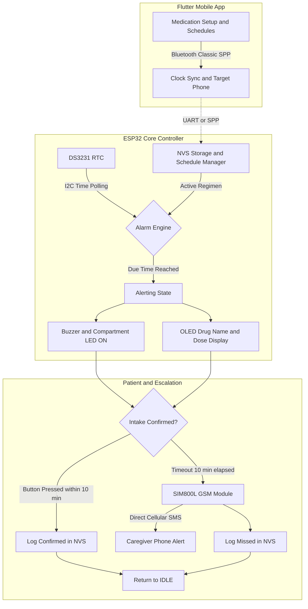

# CareBox — Smart Medication Adherence Dispenser

> Fully autonomous, offline-first smart pill dispenser with real-time audio-visual scheduling, GSM SMS emergency escalation, and companion Bluetooth mobile configuration.

[](https://www.espressif.com/)
[](https://platformio.org/)
[](https://flutter.dev/)
[]()
[](LICENSE)

---

## Overview

**CareBox** is a standalone, patient-centric smart pill dispenser designed to address medication adherence for elderly patients and individuals managing chronic therapies.

Unlike conventional IoT dispensers that rely on cloud infrastructure and continuous internet connectivity, CareBox is designed **offline-first**:
1. Keeps accurate local time via an onboard battery-backed Real-Time Clock (DS3231).
2. Visually highlights the exact pill compartment using dedicated LEDs while guiding the user with an SSD1306 OLED screen and audio buzzer.
3. If an alert is ignored for 10 minutes, CareBox automatically escalates by sending an SMS alert directly to a designated caregiver through an onboard SIM800L GSM cellular module.
4. Caregivers configure dosing schedules and phone numbers offline via Bluetooth Classic SPP using the accompanying cross-platform Flutter mobile application.

---

## Features

- **Autonomous Offline Scheduling**: Stores full dosing regimens in ESP32 Non-Volatile Storage (NVS). Time is maintained reliably across power cycles by a DS3231 I2C RTC with coin-cell backup.
- **Compartment-Targeted Visual Guidance**: Distinct LED indicators above each modular pill bin light up exclusively when that specific medication is due.
- **Interactive Patient Feedback**: High-contrast 0.96" OLED displays medication name, dosage, and current time. A physical debounce-filtered tactile button confirms dosage intake.
- **Fail-Safe Cellular Escalation**: If a scheduled dose is not confirmed within a 10-minute grace window, the onboard SIM800L module dispatches an SMS alert directly to the caregiver.
- **Bluetooth SPP Mobile Companion**: Intuitive Flutter app to pair, synchronize system clock, register medications, and manage emergency contacts without internet access.
- **Modular Hardware Form Factor**: Decoupled electronics core from clip-on physical pill bins, allowing dynamic expansion of compartment counts.

---

## Tech Stack & Hardware Components

### Hardware Components

| Category | Component | Interface / Spec | Purpose |
|---|---|---|---|
| **MCU** | ESP32-WROOM-32 / ESP32-C3 | Dual-Core, 2.4 GHz Bluetooth & WiFi | System orchestration, scheduling, and Bluetooth SPP server |
| **Real-Time Clock** | DS3231 RTC Module | I2C (Address: `0x68`), CR2032 Backup | High-precision temperature-compensated real-time timekeeping |
| **Display** | SSD1306 0.96" OLED | I2C (Address: `0x3C`), 128x64 Monochrome | Displays live clock, patient prompts, dose names, and status |
| **Cellular** | SIM800L GSM Module | Hardware UART (`AT` command protocol) | Dispatches standalone SMS notifications to caregivers |
| **Audio Alert** | Active 5V Buzzer | GPIO Driven (PWM/Digital) | Acoustic alarm patterns for medication reminders |
| **Indicators** | Modular 5mm LEDs | Current-limited GPIO (220 Ohm) | Highlights the specific physical compartment to open |
| **Input** | Momentary Push Button | GPIO with internal pull-up | Patient intake confirmation |
| **Power Management** | TP4056 + Li-ion 18650 | 3.7V Nominal, 3.3V LDO Regulated | Rechargeable portable power with 24-48h continuous autonomy |

### Software Stack

- **Firmware**: C++ (Arduino Core / PlatformIO), FreeRTOS, `U8g2` (OLED graphics), `RTClib`, `Preferences` (NVS)
- **Mobile Application**: Flutter 3.x, Dart, `flutter_bluetooth_serial`, Provider state management

---

## System Architecture



---

## Project Structure

```text
carebox/
├── firmware/                        # ESP32 Embedded Firmware (PlatformIO)
│   ├── include/
│   │   ├── config.h                 # Pin definitions and global constants
│   │   └── state_machine.h          # System state transitions
│   ├── src/
│   │   ├── main.cpp                 # Entrypoint, FreeRTOS tasks, scheduler
│   │   ├── bt_spp.cpp               # Bluetooth SPP command interpreter
│   │   ├── nvs_manager.cpp          # Non-volatile storage of schedules
│   │   ├── rtc_manager.cpp          # DS3231 driver & time synchronization
│   │   ├── oled_manager.cpp         # SSD1306 U8g2 display layout renderer
│   │   └── sim800l.cpp              # Cellular AT command orchestration
│   └── platformio.ini               # Build configuration, board, and dependencies
│
├── mobile_app/                      # Companion Mobile Application (Flutter)
│   ├── lib/
│   │   ├── main.dart                # App entrypoint & theme
│   │   ├── providers/               # Bluetooth state & device controllers
│   │   └── screens/                 # Connection, Schedule, and Settings UI
│   └── pubspec.yaml                 # Flutter dependencies and assets
│
├── docs/                            # Engineering & Architecture Plans
│   ├── CareBox_Architecture_Plan.md # In-depth hardware and protocol specs
│   └── wiring_diagram.png           # Breadboard / PCB electrical pinout
└── README.md
```

---

## Getting Started

### 1. Hardware Pinout & Wiring

| ESP32 Pin | Connected Peripheral | Protocol / Function |
|---|---|---|
| `GPIO 21` (SDA) | DS3231 RTC & SSD1306 OLED | I2C Data Line |
| `GPIO 22` (SCL) | DS3231 RTC & SSD1306 OLED | I2C Clock Line |
| `GPIO 16` (RX2) | SIM800L TX | Hardware Serial 2 |
| `GPIO 17` (TX2) | SIM800L RX | Hardware Serial 2 |
| `GPIO 4` | Push Button | Input (Active LOW, Internal Pull-Up) |
| `GPIO 5` | Active Buzzer | Output |
| `GPIO 18, 19, ...` | Compartment LEDs | Output (via 220 Ohm resistor) |

Power Note: The SIM800L module experiences brief cellular transmission bursts requiring up to 2A peak current. Connect a 1000 uF electrolytic capacitor directly across its VCC and GND rails to prevent brownouts.

### 2. Flashing the Firmware

```bash
git clone https://github.com/SalahLai/carebox-medication-dispenser.git
cd carebox-medication-dispenser/firmware
pio run --target upload
pio device monitor --baud 115200
```

### 3. Running the Mobile App

```bash
cd ../mobile_app
flutter pub get
flutter run
```

---

## Status & Roadmap

- [x] DS3231 Real-Time Clock integration with I2C bus recovery
- [x] SSD1306 OLED multi-screen UI engine (Idle clock, alert prompt, config mode)
- [x] Bluetooth Classic SPP command parser and local NVS schedule storage
- [x] SIM800L GSM autonomous SMS alerting on missed dose timeouts
- [x] Cross-platform Flutter companion application for offline management
- [ ] Custom two-layer KiCad PCB replacing breadboard harness
- [ ] 3D-printable modular snap-fit housing files (STL/STEP)

---

## Author

**Salah Lai**
- GitHub: [@SalahLai](https://github.com/SalahLai)
- Email: salah.lai.icloud@gmail.com

---

## License

This project is open-source and licensed under the [MIT License](LICENSE).


